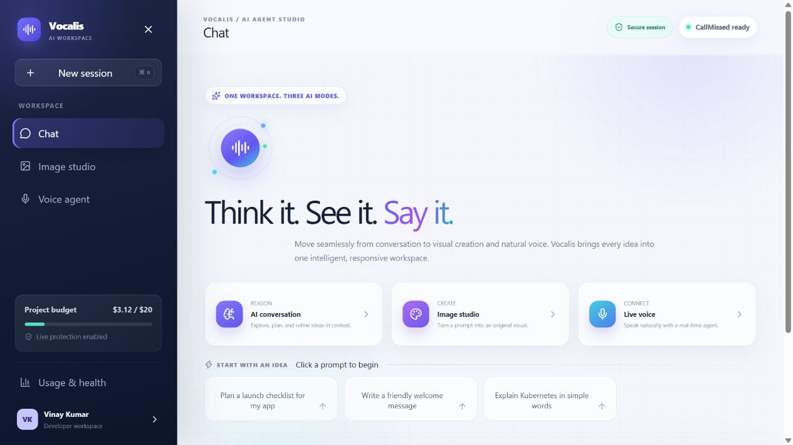
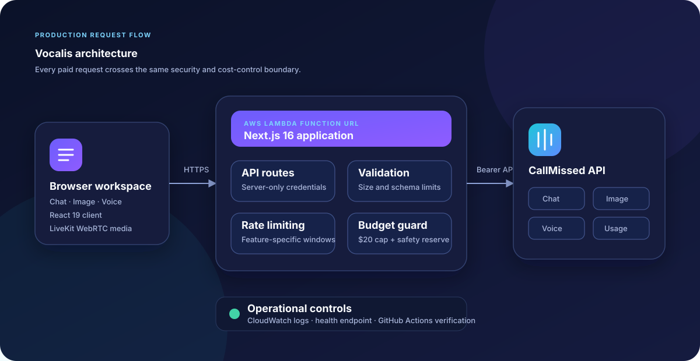

# Vocalis — AI Agent Studio

<p align="center">
  <strong>Think it. See it. Say it.</strong><br />
  One polished workspace for AI chat, image generation, and real-time voice.
</p>

<p align="center">
  <a href="https://bfuwy3hkj5viotgszj6q2i6cyy0fuazi.lambda-url.ap-south-1.on.aws/"><strong>Open the live application</strong></a>
  ·
  <a href="#architecture">Architecture</a>
  ·
  <a href="#run-locally">Run locally</a>
</p>

<p align="center">
  
  
  
  
  
</p>



## Why Vocalis

Vocalis was built as a four-day engineering challenge: create and deploy a voice-agent platform using **only the CallMissed API** for AI capabilities while keeping a strict **$20 project budget**.

The result is a responsive, production-minded application where a user can move between three complementary modes without leaving the workspace:

- **AI conversation** — contextual chat powered by `sarvam-105b`.
- **Image studio** — 768 × 768 image generation with `sdxl-lightning`, including preview and download.
- **Live voice** — real-time speech through a three-minute WebRTC session using Saaras STT, Sarvam LLM, and Bulbul TTS.
- **Usage and health** — live service status, consumption metrics, and project-budget visibility.

## Engineering highlights

- Keeps the CallMissed credential exclusively on the server.
- Applies per-client rate limits independently to chat, image, and voice workloads.
- Stops paid requests near the configured project budget and accounts for pre-existing API usage with a baseline.
- Validates request sizes and caps generated output to reduce accidental spend.
- Uses timeouts and friendly upstream error mapping for resilient failure handling.
- Restricts browser permissions and applies defensive response headers.
- Runs as a standalone Next.js server on an AWS Lambda Function URL.
- Verifies lint and the production AWS build on every push and pull request.

## Architecture



All paid calls pass through the same server-side control path:

1. Validate the request and identify the client.
2. Enforce the feature-specific rate limit.
3. Check project spend against the configured CallMissed budget.
4. Call the relevant CallMissed service without exposing the API key.
5. Return only the data required by the browser.

For voice, the server creates a short-lived session and the browser then connects to the media server using the returned one-time WebRTC URL and token.

## Technology

| Layer | Choice |
| --- | --- |
| Front end | React 19, TypeScript, custom responsive CSS, Lucide icons |
| Application | Next.js 16 App Router and server route handlers |
| AI platform | CallMissed chat, image, usage, credit, and voice APIs |
| Voice transport | LiveKit WebRTC client |
| Hosting | AWS Lambda, public HTTPS Function URL, Lambda Web Adapter |
| Infrastructure | Terraform, CloudWatch log retention, AWS Budget alert |
| Delivery | Docker-compatible build and GitHub Actions CI |

## API surface

| Route | Purpose | Primary protection |
| --- | --- | --- |
| `POST /api/chat` | Contextual AI conversation | 12 requests/minute, 20-message limit, 30-second timeout |
| `POST /api/images` | Generate one 768 × 768 image | 4 requests/10 minutes, 90-second timeout |
| `POST /api/voice/session` | Create a real-time voice session | 3 sessions/hour, 3-minute maximum session |
| `GET /api/usage` | Show project usage and remaining budget | Server-only API access, uncached response |
| `GET /api/health` | Deployment readiness check | No paid upstream request |

## Run locally

### Requirements

- Node.js 22.13 or newer
- pnpm 11.25
- A CallMissed API key with LLM, image, STT, and TTS permissions

### Setup

```bash
pnpm install
cp .env.example .env.local
pnpm dev
```

Update `.env.local` with your credential:

```dotenv
CALLMISSED_API_KEY=your_private_key
```

The key must never be placed in browser code or committed to Git.

## Configuration

| Variable | Purpose | Default |
| --- | --- | --- |
| `CALLMISSED_API_KEY` | Private bearer token used by server routes | Required |
| `CALLMISSED_API_URL` | CallMissed API base URL | `https://api.callmissed.com/v1` |
| `CALLMISSED_BUDGET_USD` | Maximum project spend | `20` |
| `CALLMISSED_BUDGET_RESERVE_USD` | Safety reserve before the hard limit | `0.25` |
| `CALLMISSED_BUDGET_BASELINE_USD` | Existing account spend excluded from this project | `0` |

## Quality checks

```bash
pnpm lint
pnpm build:aws
```

The GitHub Actions workflow runs both commands from a clean install.

## AWS deployment

The production package runs on AWS Lambda in `ap-south-1` behind a Function URL. Deployment assets in [`infra/aws`](infra/aws/README.md) include:

- Lambda configuration suitable for a low-traffic demonstration.
- Seven-day CloudWatch log retention.
- An optional AWS monthly-budget alert.
- Terraform variables that intentionally exclude the CallMissed secret.

Store the API key in the Lambda environment or an approved secret manager—never in Terraform state.

## Project structure

```text
app/
  api/                  Server-side CallMissed integrations
  globals.css           Responsive visual system
  page.tsx              Chat, image, voice, and usage workspace
components/             Reusable interface primitives
lib/
  budget-guard.ts       Project-spend enforcement
  rate-limit.ts         Per-client feature throttling
infra/
  aws/                  Terraform deployment definition
  cloudshell/           Repeatable Lambda packaging scripts
docs/                   Architecture and product preview
.github/workflows/      Automated verification
```

## Design decisions

- **Lambda over a continuously running VM:** keeps idle infrastructure cost low for a demonstration application.
- **Server-side API gateway pattern:** prevents the private CallMissed credential from reaching the browser.
- **Budget baseline:** isolates project spend when an API account already contains historical usage.
- **Short voice sessions:** limits exposure to the most expensive real-time workflow.
- **Single workspace UI:** makes the three AI modes feel like one coherent product rather than separate demos.

## Current status

The application is live and the chat, image, voice, health, and budget flows have been verified against the production deployment.

> This repository is a technical-assignment project and is not affiliated with or endorsed by CallMissed.
